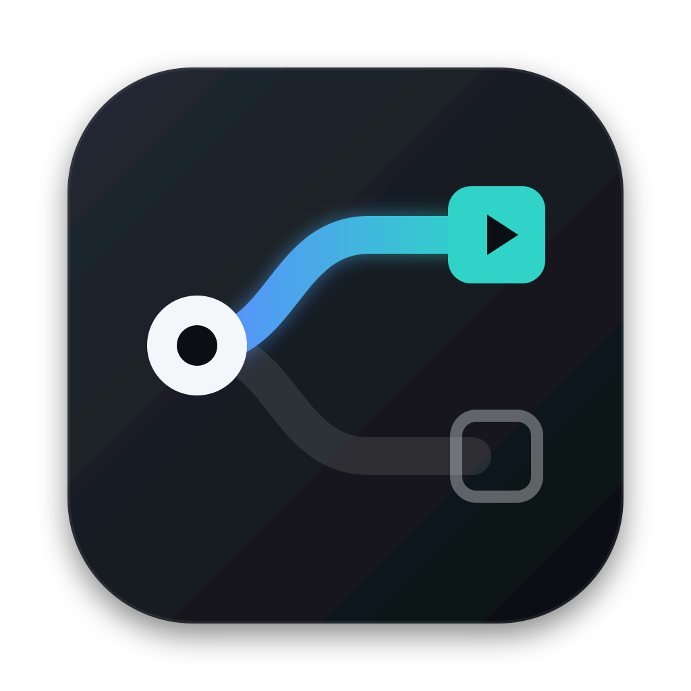
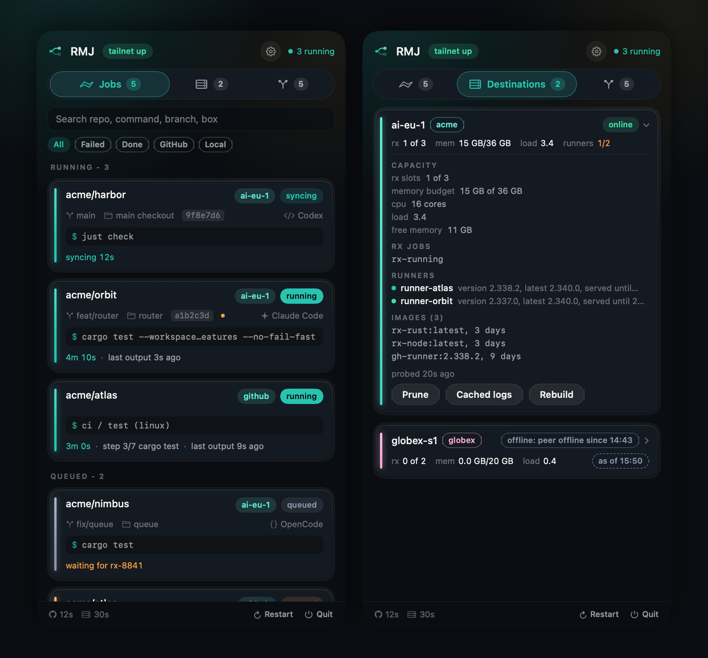
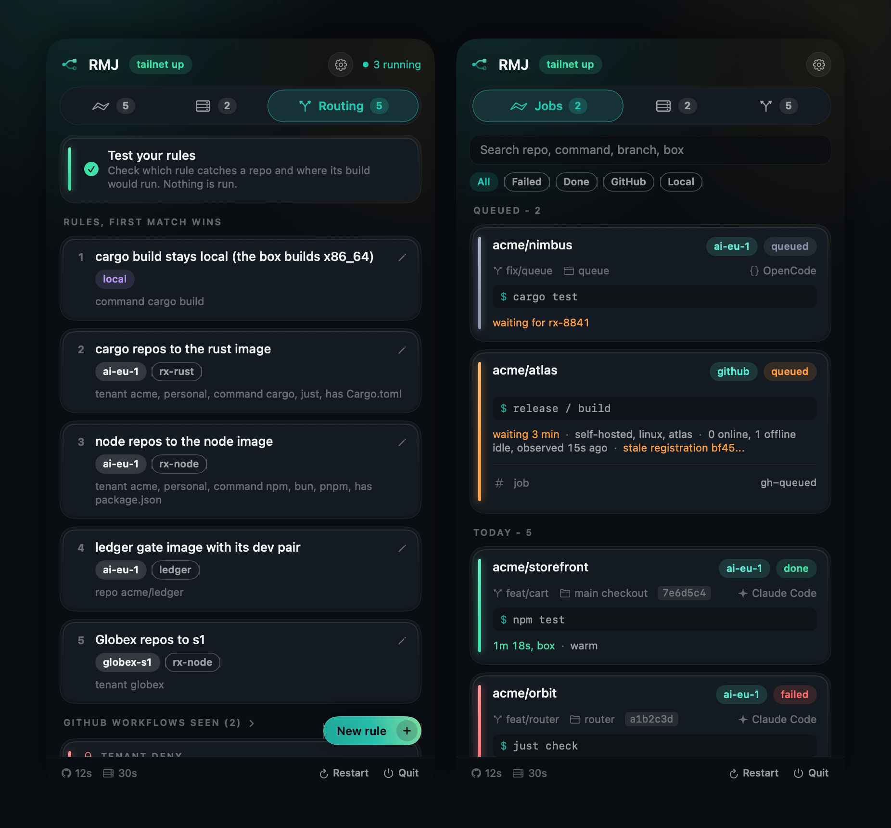
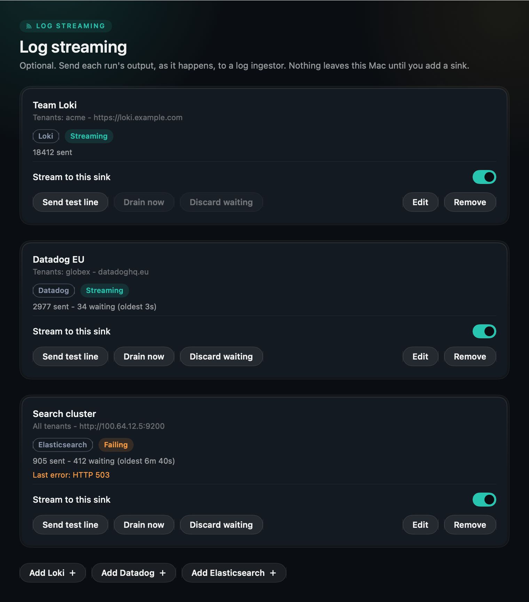

<p align="center">
  
</p>

<h1 align="center">Run My Job (RMJ)</h1>

<p align="center">
  <b>Your builds run on your boxes. Your Mac stays quiet.</b><br>
  RMJ sends the Rust, Node and other builds and test suites your coding agents start to the Linux machines on<br>
  your <a href="https://tailscale.com">Tailscale</a> network, runs your self-hosted GitHub Actions runners there, and shows every job in one list.
</p>

<p align="center">
  
  
  
  
</p>

<!-- The launch film (runmyjob.mp4): drag it into the GitHub editor and paste the user-attachments URL on its own
     line here; that is the only way GitHub plays a video inline. -->

> **Status:** early releases. The app is signed ad hoc, not notarized, so macOS asks you to confirm the first open.
> Report anything wrong at [github.com/danieltamas/runmyjob/issues](https://github.com/danieltamas/runmyjob/issues).

## Install

Open **Terminal** and paste this:

```bash
curl -fsSL https://raw.githubusercontent.com/danieltamas/runmyjob/main/install.sh | bash
```

Or, with Homebrew:

```bash
brew install --cask danieltamas/tap/rmj
```

It needs macOS 14 or newer. RMJ appears in the menu bar a few seconds later, and the `rmj` command lands in `~/.local/bin`.
The install line downloads the release, checks it against the published checksum and copies RMJ to `/Applications`
(or `~/Applications` if you cannot write there); [read the script](install.sh) first if you like. When a new version is
out, an arrow appears in the panel header and the Update button in Settings, About installs it.

## Every run in one place

<p align="center">
  
</p>

- **Jobs from every source in one list.** A `cargo test` an agent started in a worktree, a `just check` from your
  terminal, the `test` job of a pull request on your self-hosted runner. Live elapsed time, the exact start and end
  read from the box itself, sync time apart, and who started it (Claude Code, Codex, OpenCode, Hermes).
- **Your boxes at a glance.** Slots in use, memory budget, load, the runners online or busy, and the images RMJ uses on
  each box, refreshed every five minutes.
- **Failures keep their log.** A failed run's output is pulled the moment it fails and kept 30 days, with a rerun button.

## You decide where each build runs

<p align="center">
  
</p>

- **Rules you can read, first match wins.** Rust repos to the Rust image on one box, Node repos to the Node image,
  `cargo build` for this Mac's own binary stays on the Mac, one company's repos to that company's box. Press "New
  rule", pick the toolchain, the boxes and optionally the repos; "Test your rules" shows which rule catches a repo and
  where its build would go, without running anything.
- **A boundary no rule crosses.** Give each company a tenant: its repos never reach another tenant's box. Tested, not
  just documented.
- **Waiting says why.** A job queued on a busy box names the job it waits for; a GitHub job queued on your runners names
  the cause, for example a stale registration, and offers the prune button.
- **Local always works.** No box, no tailnet, a failed sync: the command runs on your Mac and the list says why. A
  red test suite is never a reason to fall back.

## Boxes you do not manage by hand

Add a Linux machine from your tailnet and press Set up. RMJ makes the box ready and changes only what differs, so you can
run it again any time.

- **Every job runs in a Docker container; the box itself carries only Docker, rsync and ssh.** Nothing of RMJ is
  installed on the host besides one script. RMJ ships and builds four toolchain images, `rx-rust` (cargo, just), `rx-node` (node, bun), `rx-python` (python, uv,
  pytest) and `rx-go` (go), all with bash, zsh, git and jq, and rebuilds one when its Dockerfile in RMJ changes. A rule's
  image is just a name, so any other Docker image (your own, or `ruby:3.3`) works the same way.
- **Tools are checked inside the image,** not on the host. The box's card lists what is missing in which image, and
  Set up tells you which Dockerfile to add it to.
- **Containers are locked down by default:** no Linux capabilities, no privilege gain, a process limit, the box user's
  own uid, and memory and CPU limits from the rule. A rule can switch it off with `"hardening": false`.
- **Self-hosted GitHub Actions runners,** one per repo or organization you name: registered with a token kept in your
  Keychain, checked against GitHub, listed with their version and whether they are idle or busy.
- **What runs where:** Linux builds. Swift packages that import AppKit or SwiftUI build only on a Mac, so RMJ does not
  route them.

## Tailscale

RMJ talks to your machines through [Tailscale](https://tailscale.com) and nothing else. Set it up once:

1. **On your Mac:** install Tailscale from <https://tailscale.com/download> and sign in.
2. **On every box that should run jobs:** install it too ([Linux install](https://tailscale.com/kb/1031/install-linux)),
   then `sudo tailscale up` and sign in to the **same tailnet**.
3. **On every box:** `ssh`, `docker` and `rsync` must work for your user. Put your public key in
   `~/.ssh/authorized_keys` and make sure `ssh <box>` works from your Mac once, so the host key is known.
4. **Check:** `tailscale status` on the Mac lists the box. In RMJ, Settings > Destinations shows every
   Linux machine on the tailnet with its OS, memory and disk. Press "Add as destination".

You do not need to open any port, forward anything or expose a box to the internet. Tailscale's
[ACLs](https://tailscale.com/kb/1018/acls) can restrict which of your devices may reach a box; RMJ works with any ACL
that lets your Mac ssh to it.

### Why Tailscale only

Build boxes hold your source code and your CI credentials. That is exactly what should never sit
behind a public address, so RMJ has no public-IP mode and no fallback transport to switch on.

- **Every connection goes to the peer's current tailnet address**, read from Tailscale's own peer list
  by the stored node ID at the moment of connecting. A hostname, a DNS answer or a line in
  `~/.ssh/config` cannot send a job somewhere else.
- **Your code only moves between machines you own.** If a box is not on your tailnet, it is not a
  destination. There is no relay, no cloud queue and no account with us; RMJ has no server.
- **Down means local, not elsewhere.** When Tailscale is off or a box is unreachable, the job runs on
  your Mac and the panel says `local: tailnet down`. It never tries another route.
- **Host keys are strict.** A changed host key is an error, never accepted silently.
- **Two companies never mix.** A tenant boundary in the rules is a hard deny: one company's repos
  never reach another company's boxes, and the reverse. This is tested, not just documented.

The full threat model is in [SECURITY.md](SECURITY.md).

## First run

1. Open RMJ from the menu bar. The tab bar shows Jobs, Destinations and Routing.
2. **Destinations:** Settings > Destinations, press "Add as destination" on a Linux box, name it,
   pick its company (tenant). RMJ asks for a GitHub token once per GitHub owner, stores it in your
   Keychain and sets the box up.
3. **Routing:** press "New rule". Pick what (Rust, Node, ...), where (your boxes, then this Mac) and,
   if you like, which repos.
4. **Run something:** in a checkout, `rmj route -- cargo test` says where it would run, and
   `rmj run -- cargo test` runs it there. The panel shows it live.

## For agents

RMJ is made to sit under coding agents (Claude Code, Codex, OpenCode, Hermes). Run
`rmj hooks install claude-code` or press Install in Settings > Hooks: a bare `cargo test` or `just check` is
then blocked with the `rmj run` form, so it lands on a box and in the panel. Codex, OpenCode and Hermes get shims.
`rmj mcp` is a read-only MCP server (jobs, logs, failures, routes), off until you switch it on in Settings > Agent
access. Details in [docs/AGENT-API.md](docs/AGENT-API.md).

## Log streaming

Settings > Log streaming adds a sink: Loki, Datadog Logs or Elasticsearch/OpenSearch. A sink names the
tenants it may receive (or `all`); output of any other tenant never reaches it. Every line carries the
job, line number, repo, branch, agent and destination. Secrets are redacted and terminal escapes stripped
before a line is written anywhere.



Delivery is asynchronous and never holds a run. Lines go to a spool on disk per sink (`~/.rmj/spool/`),
are sent in the background and deleted only after the ingestor accepted them; an ingestor that is down
just means the spool grows (256 MB and 7 days at most) and drains when it is back. Keys live in the
Keychain. Details: [docs/LOG-STREAMING.md](docs/LOG-STREAMING.md).

## The `rmj` command

| Command | What it does |
| --- | --- |
| `rmj route -- cargo test` | where this would run, and why, without running it |
| `rmj run -- cargo test` | route, run and track it; the exit code is the command's |
| `rmj jobs`, `rmj job <id>`, `rmj log <id>` | the ledger: state, timings, the archived log |
| `rmj failures`, `rmj destinations`, `rmj runners` | what failed, what the boxes are doing (`--json` for scripts) |
| `rmj rerun <id>`, `rmj cancel <id>` | run it again, stop it |
| `rmj destination setup <name>` | bring a box to ready (idempotent) |
| `rmj hooks install\|status\|remove` | agent hooks and shims |
| `rmj sinks`, `rmj sinks test <id>` | log sinks: state and what waits; send one test line |
| `rmj mcp` | the MCP server over stdio |

## Build and test

```bash
SCRATCH=$HOME/.cache/rmj-build
swift build --build-tests --scratch-path "$SCRATCH"
swift test --skip-build --scratch-path "$SCRATCH"
scripts/check.sh --scratch "$SCRATCH"
```

SwiftPM only, Swift 6, no third-party packages, no telemetry.

## More from the same maker

Settings > More apps lists the maker's other tools, read from the
[registry](https://github.com/danieltamas/registry) (a bundled copy offline, a refresh at most hourly from
`raw.githubusercontent.com/danieltamas/registry`, nothing else).

RMJ does not need any of them, and none of them need RMJ.

## License

MIT. See [LICENSE](LICENSE).
