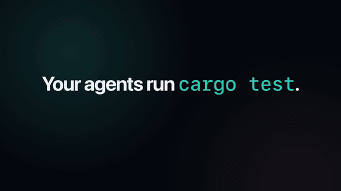
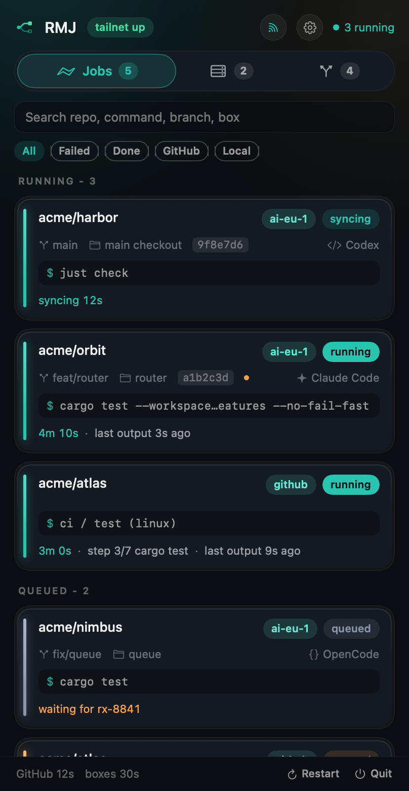
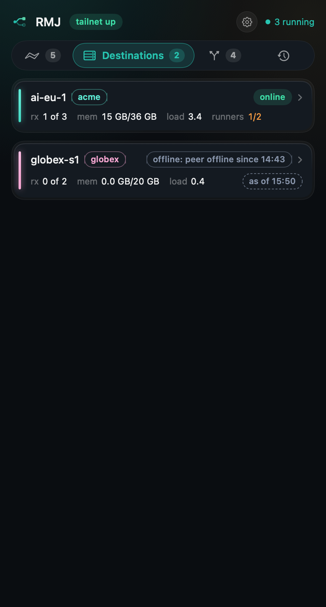
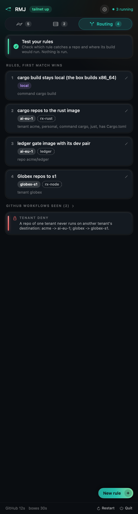
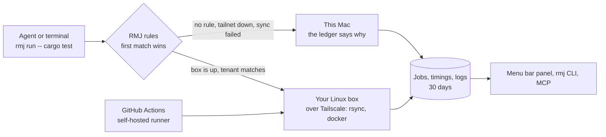

<p align="center">
  
</p>

<h1 align="center">Run My Job (RMJ)</h1>

<p align="center">
  <b>Your builds and tests, on your boxes, watched from the menu bar.</b><br>
  RMJ sends the builds, test suites and CI jobs your coding agents start to the Linux machines on your
  <a href="https://tailscale.com">Tailscale</a> network,<br>and shows every run in one place: what is running, how long it took, what failed, and where the log is.
</p>

<p align="center">
  
  
  
  
</p>

<p align="center">
  
</p>

<table>
  <tr>
    <td width="33%"><br><sub><b>Jobs.</b> Every run in one list, live.</sub></td>
    <td width="33%"><br><sub><b>Destinations.</b> Your boxes, runners, capacity.</sub></td>
    <td width="33%"><br><sub><b>Routing.</b> Rules you write, a boundary no rule crosses.</sub></td>
  </tr>
</table>

## How it works



> **Status.** The app, the `rmj` command, routing, the GitHub poller, box setup, agent hooks and a read-only MCP
> server (`rmj mcp`) are built and tested. Releases are ad hoc signed, not notarized, and the first one is not out yet:
> [docs/PLAN.md](docs/PLAN.md) lists what is done and what is next.

## What you get

- **One list of jobs**, wherever they run: a `cargo test` started in a worktree, a `just check` from
  your terminal, the `check` job of a pull request on your self-hosted runner. Live elapsed time,
  exact start and end from the box itself, sync time apart.
- **Routing by rules you write.** Which repo goes to which box, with which image, what stays on your
  Mac, and a company boundary no rule can cross. Add a rule from the panel: pick a toolchain (Node,
  Rust, Swift, Python, Go or anything), pick the boxes, save. The rules live in one file the app edits
  and the CLI reads, so a build routes right even when the app is closed.
- **Boxes you do not manage by hand.** Add a Linux machine from your tailnet and RMJ sets it up:
  build images, a GitHub Actions runner for every repo or organization you name, registration
  checked against GitHub. Nothing is installed on the box beyond what runs in docker.
- **Destinations you can see.** OS, memory and disk of every tailnet machine, refreshed every five
  minutes; runners online, busy or unregistered; images; a stale registration gets a prune button.
- **One list, 30 days, searchable.** Durations, waits and their reasons, local fallbacks, a failed run's log
  pulled the moment it fails, a rerun button.
- **Optional log streaming.** Send every run's output, as it happens, to Loki, Datadog or Elasticsearch,
  several at once, each limited to the tenants you name. Off until you add a sink; a small glyph in the
  panel header shows when it is on and turns amber when a sink is behind. See [Log streaming](#log-streaming).
- **Local always works.** No box, no tailnet, a failed sync: the command runs on your Mac and the
  ledger says why. A red test suite is never a reason to fall back.

## Tailscale

RMJ talks to your machines through [Tailscale](https://tailscale.com) and nothing else. Set it up once:

1. **On your Mac:** install Tailscale from <https://tailscale.com/download> and sign in.
2. **On every box that should run jobs:** install it too ([Linux install](https://tailscale.com/kb/1031/install-linux)),
   then `sudo tailscale up` and sign in to the **same tailnet**.
3. **On every box:** `ssh`, `docker` and `rsync` must work for your user. Put your public key in
   `~/.ssh/authorized_keys` and make sure `ssh <box>` works from your Mac once, so the host key is known.
4. **Check:** `tailscale status` on the Mac lists the box. In RMJ, Settings > Destinations shows every
   Linux machine on the tailnet with its OS, memory and disk. Press "Add as destination".

You do not need to open any port, forward anything or expose a box to the internet. Tailscale's
[ACLs](https://tailscale.com/kb/1018/acls) can restrict which of your devices may reach a box; RMJ works with any ACL
that lets your Mac ssh to it.

### Why Tailscale only

Build boxes hold your source code and your CI credentials. That is exactly what should never sit
behind a public address, so RMJ has no public-IP mode and no fallback transport to switch on.

- **Every connection goes to the peer's current tailnet address**, read from Tailscale's own peer list
  by the stored node ID at the moment of connecting. A hostname, a DNS answer or a line in
  `~/.ssh/config` cannot send a job somewhere else.
- **Your code only moves between machines you own.** If a box is not on your tailnet, it is not a
  destination. There is no relay, no cloud queue and no account with us; RMJ has no server.
- **Down means local, not elsewhere.** When Tailscale is off or a box is unreachable, the job runs on
  your Mac and the panel says `local: tailnet down`. It never tries another route.
- **Host keys are strict.** A changed host key is an error, never accepted silently.
- **Two companies never mix.** A tenant boundary in the rules is a hard deny: one company's repos
  never reach another company's boxes, and the reverse. This is tested, not just documented.

The full threat model is in [SECURITY.md](SECURITY.md).

## Install

From a checkout (macOS 14 or newer, Xcode command line tools):

```bash
git clone https://github.com/danieltamas/runmyjob && cd runmyjob
scripts/install-from-source.sh     # installs RMJ.app and the `rmj` command
```

The app is signed ad hoc, not notarized, so macOS asks you to confirm the first open. Release
installs (`install.sh`) arrive with the first signed release.

## First run

1. Open RMJ from the menu bar. The tab bar shows Jobs, Destinations and Routing.
2. **Destinations:** Settings > Destinations, press "Add as destination" on a Linux box, name it,
   pick its company (tenant). RMJ asks for a GitHub token once per GitHub owner, stores it in your
   Keychain and sets the box up. Run it again any time: it only changes what differs.
3. **Routing:** press "New rule". Pick what (Rust, Node, ...), where (your boxes, then this Mac) and,
   if you like, which repos. "Test your rules" shows which rule catches a repo and where its build would go.
4. **Run something:** in a checkout, `rmj route -- cargo test` says where it would run, and
   `rmj run -- cargo test` runs it there. The panel shows it live.

## For agents

RMJ is made to sit under coding agents (Claude Code, Codex, OpenCode, Hermes). Run
`rmj hooks install claude-code` or press Install in Settings > Hooks: a bare `cargo test` or `just check` is
then blocked with the `rmj run` form, so it lands on a box and in the panel. Codex, OpenCode and Hermes get shims.
`rmj mcp` is a read-only MCP server (jobs, logs, failures, routes), off until you switch it on in Settings > Agent
access. Details in [docs/AGENT-API.md](docs/AGENT-API.md).

## Log streaming

Settings > Log streaming adds a sink: Loki, Datadog Logs or Elasticsearch/OpenSearch. A sink names the
tenants it may receive (or `all`); output of any other tenant never reaches it. Every line carries the
job, line number, repo, branch, agent and destination. Secrets are redacted and terminal escapes stripped
before a line is written anywhere.


Delivery is asynchronous and never holds a run. Lines go to a spool on disk per sink (`~/.rmj/spool/`),
are sent in the background and deleted only after the ingestor accepted them; an ingestor that is down
just means the spool grows (256 MB and 7 days at most) and drains when it is back. Keys live in the
Keychain. Details: [docs/LOG-STREAMING.md](docs/LOG-STREAMING.md).

## The `rmj` command

| Command | What it does |
| --- | --- |
| `rmj route -- cargo test` | where this would run, and why, without running it |
| `rmj run -- cargo test` | route, run and track it; the exit code is the command's |
| `rmj jobs`, `rmj job <id>`, `rmj log <id>` | the ledger: state, timings, the archived log |
| `rmj failures`, `rmj destinations`, `rmj runners` | what failed, what the boxes are doing (`--json` for scripts) |
| `rmj rerun <id>`, `rmj cancel <id>` | run it again, stop it |
| `rmj destination setup <name>` | bring a box to ready (idempotent) |
| `rmj hooks install\|status\|remove` | agent hooks and shims |
| `rmj sinks`, `rmj sinks test <id>` | log sinks: state and what waits; send one test line |
| `rmj mcp` | the MCP server over stdio |

## Build and test

```bash
SCRATCH=$HOME/.cache/rmj-build
swift build --build-tests --scratch-path "$SCRATCH"
swift test --skip-build --scratch-path "$SCRATCH"
scripts/check.sh --scratch "$SCRATCH"
```

SwiftPM only, Swift 6, no third-party packages, no telemetry.

## More from the same maker

Settings > More apps lists the maker's other tools, read from the
[registry](https://github.com/danieltamas/registry) (a bundled copy offline, a refresh at most hourly from
`raw.githubusercontent.com/danieltamas/registry`, nothing else).

RMJ does not need any of them, and none of them need RMJ.

## License

MIT. See [LICENSE](LICENSE).
